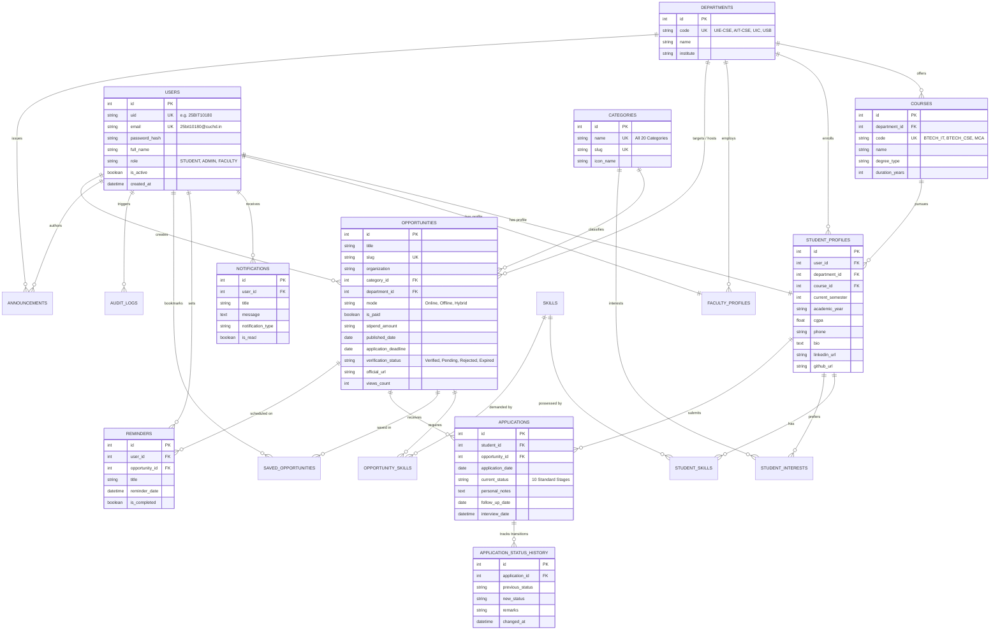

# CU OPPORTUNITY HUB – Database Architecture & Entity Relationship Diagram
**Institution:** Chandigarh University (CU)  
**RDBMS:** MySQL 8.0+ / SQLite 3.x (Development Fallback)  
**ORM:** SQLAlchemy (Python 3.14+)  

---

## 1. Visual Entity Relationship Diagram (ERD)

---

## 2. Normalization Analysis

### First Normal Form (1NF)
* Every table features an explicit primary key (`id` integer).
* Attribute values are atomic: multi-valued lists (such as student technical skills and target opportunity competencies) are normalized into associative relationship entities (`student_skills`, `opportunity_skills`, `student_interests`).

### Second Normal Form (2NF)
* All non-key attributes are fully functionally dependent on the complete primary key.
* Associative tables with composite keys (`student_id, skill_id` and `opportunity_id, skill_id`) depend solely on both composite columns.

### Third Normal Form (3NF)
* Non-key attributes depend strictly and directly on the primary key without transitive dependencies.
* Departmental and Course attributes exist in their respective parent entities (`departments`, `courses`) rather than redundantly copying institute names across student records or opportunity records.

---

## 3. High-Performance Indexing Strategy
To handle university-wide concurrency across tens of thousands of active students, key composite and single-column B-tree indexes are implemented:
* `idx_opportunities_deadline` (`application_deadline`): Instant filtering for closing-soon queries (< 7 days) and expired items.
* `idx_opportunities_category` (`category_id`): Rapid tab filtering across all 20 categories.
* `idx_applications_student` (`student_id`): Real-time retrieval of student application boards.
* `idx_notifications_user` (`user_id, is_read`): Zero-latency unread badge counts on navbar render.
